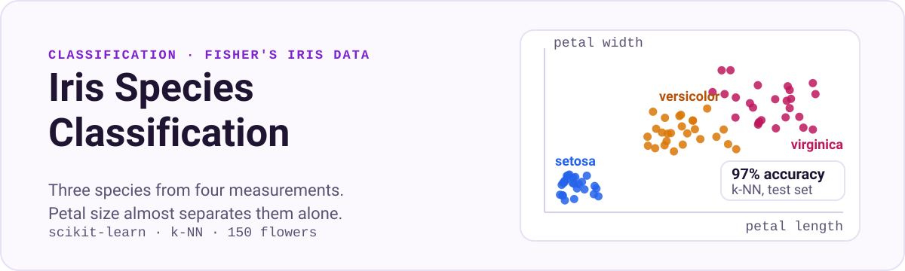

<p align="center">
  
</p>

<p align="center">
  <a href="#result"><b>Result</b></a> &nbsp;·&nbsp; <a href="#run-it"><b>Run it</b></a>
</p>

Classifies iris flowers into three species (setosa, versicolor, virginica) from four measurements: sepal length, sepal width, petal length and petal width. The data is Ronald Fisher's classic Iris dataset, loaded from scikit-learn.

## Result

| Model | Split | Test accuracy |
|:--|:--|:--|
| k-nearest neighbours (k = 1) | 112 train / 38 test | **97%** (37 of 38 flowers) |

## What the notebook does

1. **Loads the data:** 150 flowers, 50 per species, 4 numeric features.
2. **Splits it:** 75% train, 25% test (`train_test_split`, `random_state=0`).
3. **Explores it:** a pair plot of every feature against every other, coloured by species. Petal length and petal width separate the species almost on their own.
4. **Trains a k-NN classifier** with a single neighbour.
5. **Predicts a new flower:** a flower measuring 5.0 / 2.9 / 1.0 / 0.2 cm is classified as setosa.
6. **Scores it on the test set:** 0.97 accuracy.

## Run it

```bash
pip install numpy pandas matplotlib scikit-learn mglearn jupyter
jupyter notebook "Classifying Iris Species.ipynb"
```

## Files

| File | Purpose |
|:--|:--|
| `Classifying Iris Species.ipynb` | The full workflow: loading, exploration, training and evaluation |

---

<sub>Built by [Aryan Awasthi](https://github.com/Techy-A). ENC @ Thapar Institute of Engineering and Technology.</sub>
